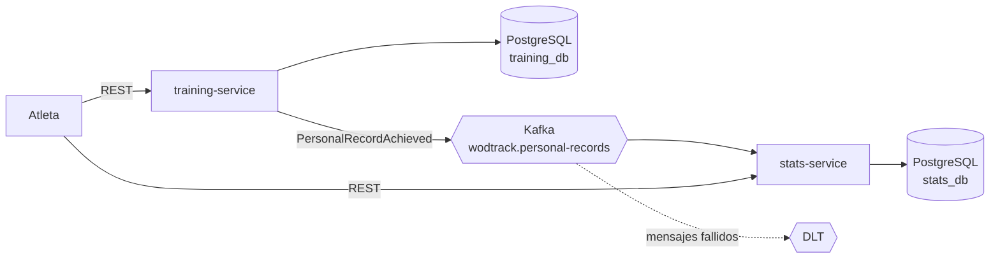

# WODTrack

Plataforma para registrar entrenos de CrossFit construida con **microservicios en Spring Boot 4 y Java 21**, comunicados mediante **eventos con Apache Kafka**.

Registras tus entrenos y marcas personales (sentadilla, peso muerto, tiempos de WOD…). Cuando bates una marca, el sistema lo detecta, publica un evento y otro servicio calcula tu progreso y tus estadísticas.


> 🚧 **Proyecto en desarrollo.** Lo construyo semana a semana; el [roadmap](#roadmap) muestra qué está hecho y qué falta.

---

## Arquitectura



| Servicio | Responsabilidad | Base de datos | Kafka |
|---|---|---|---|
| **training-service** | API principal: atletas, ejercicios, entrenos y marcas. Detecta cuándo se bate una marca. | `training_db` | Productor |
| **stats-service** | Progreso mensual, historial de marcas y ranking, calculados a partir de los eventos. | `stats_db` | Consumidor |

### Flujo principal

1. El atleta registra un entreno en `training-service`.
2. Si alguna marca supera la anterior, se guarda y se publica el evento `PersonalRecordAchieved` en Kafka.
3. `stats-service` consume el evento y actualiza las estadísticas en su propia base de datos.
4. El atleta consulta su progreso en `stats-service`.

---

## Stack

| Área | Tecnología |
|---|---|
| Lenguaje | Java 21 |
| Framework | Spring Boot 4.1 (Web, Data JPA, Validation, Actuator) |
| Build | Maven |
| Base de datos | PostgreSQL 16 + Flyway |
| Mensajería | Apache Kafka (KRaft) + Spring Kafka |
| Tests | JUnit 5, Mockito, Testcontainers |
| Contenedores | Docker, Docker Compose |
| CI | GitHub Actions |
| Documentación API | springdoc-openapi (Swagger UI) |

---

## Estructura del repositorio

```
wodtrack/
├── README.md
├── docker-compose.yml        # PostgreSQL (y más adelante Kafka y stats-service)
├── training-service/         # Servicio 1: entrenos y marcas
│   ├── pom.xml
│   └── src/
│       ├── main/java/com/wodtrack/training/
│       ├── main/resources/
│       │   ├── application.properties
│       │   └── db/migration/   # Migraciones Flyway
│       └── test/java/
└── stats-service/            # Servicio 2: estadísticas (próximamente)
```

| Componente | Puerto |
|---|---|
| training-service | `8081` |
| stats-service | `8082` (próximamente) |
| PostgreSQL (`training_db`) | `5432` |

---

## Cómo arrancarlo

### Requisitos

- Java 21
- Docker y Docker Compose
- Maven 3.9+ (opcional: el proyecto incluye Maven Wrapper `./mvnw`)

### Arranque

```bash
git clone https://github.com/ser2697sm/wodtrack.git
cd wodtrack

# 1. Levanta PostgreSQL
docker compose up -d

# 2. Arranca training-service
cd training-service
./mvnw spring-boot:run
```

Comprueba que está funcionando:

```bash
curl http://localhost:8081/actuator/health
# {"status":"UP"}
```

> Las credenciales de `docker-compose.yml` (`wodtrack` / `wodtrack`) son solo para desarrollo local.
>
> Cuando estén listos los dos servicios y Kafka, todo se levantará con un único `docker compose up`.

### Base de datos

El esquema lo gestiona **Flyway** (`src/main/resources/db/migration`); Hibernate solo lo valida (`ddl-auto=validate`), como en un entorno real.

---

## Endpoints

### training-service (`:8081`)

| Método | Endpoint | Descripción | Estado |
|---|---|---|---|
| GET | `/actuator/health` | Estado del servicio | ✅ |
| POST | `/athletes` | Crear atleta | ✅  |
| GET | `/athletes/{id}` | Ver atleta | ✅  |
| GET / POST | `/exercises` | Listar / crear ejercicios | ✅ |
| POST | `/athletes/{id}/workouts` | Registrar un entreno | 🔜 |
| GET | `/athletes/{id}/workouts?from=&to=` | Entrenos en un rango de fechas | 🔜 |
| GET | `/athletes/{id}/records` | Marcas personales actuales | 🔜 |

### stats-service (`:8082`)

| Método | Endpoint | Descripción | Estado |
|---|---|---|---|
| GET | `/athletes/{id}/progress?exercise=` | Progreso mensual en un ejercicio | 🔜 |
| GET | `/athletes/{id}/records/history` | Historial de marcas | 🔜 |
| GET | `/rankings?exercise=` | Ranking por ejercicio | 🔜 |

---

## Decisiones de diseño

- **Dos servicios en vez de uno.** Las estadísticas se calculan de forma asíncrona para no ralentizar el registro de entrenos, y cada parte puede desplegarse y escalar por separado.
- **Una base de datos por servicio.** Cada servicio es dueño de sus datos; compartir la base de datos acoplaría los servicios.
- **Eventos en lugar de llamadas REST entre servicios.** `training-service` no necesita saber quién consume sus eventos ni esperar respuesta. Si `stats-service` cae, los eventos esperan en Kafka.
- **Clave del mensaje = `athleteId`.** Garantiza el orden de los eventos de un mismo atleta.
- **Consumidor idempotente.** Cada evento lleva un `eventId` único para no procesarlo dos veces.
- **Dead letter topic.** Un mensaje que falla siempre no bloquea al resto y queda guardado para revisarlo.

---

## Tests

```bash
cd training-service
./mvnw verify
```

- **Unitarios:** lógica de detección de marcas y cálculo de progreso (JUnit 5 + Mockito).
- **Integración:** PostgreSQL y Kafka reales con Testcontainers.

---

## Roadmap

### Fase 1 — Microservicios con Kafka

- [X] **Semana 1** — Repositorio, `training-service` con Spring Boot 4 y PostgreSQL en Docker
- [ ] **Semana 2** — CRUD de entrenos y marcas, validaciones y migraciones con Flyway
- [ ] **Semana 3** — Tests con Testcontainers y CI con GitHub Actions
- [ ] **Semana 4** — Kafka en Docker Compose
- [ ] **Semana 5** — `training-service` publica `PersonalRecordAchieved`
- [ ] **Semana 6** — `stats-service` consume el evento
- [ ] **Semana 7** — API de estadísticas
- [ ] **Semana 8** — Reintentos y dead letter topic
- [ ] **Semana 9** — Tests de integración con Kafka y Swagger
- [ ] **Semana 10** — Documentación final y versión v1.0

### Fase 2 — Cloud

- [ ] Despliegue en Kubernetes
- [ ] Despliegue en AWS con GitHub Actions

### Fase 3 — IA

- [ ] Asistente con Spring AI que consulta la API ("¿cómo he progresado en sentadilla este mes?")
- [ ] RAG sobre planes de entrenamiento con pgvector

---

## Autor

**Sergio Martínez Martínez** — Desarrollador backend Java

[LinkedIn](https://linkedin.com/in/sergio-martinez-martinez-backend-developer) · [GitHub](https://github.com/ser2697sm)
